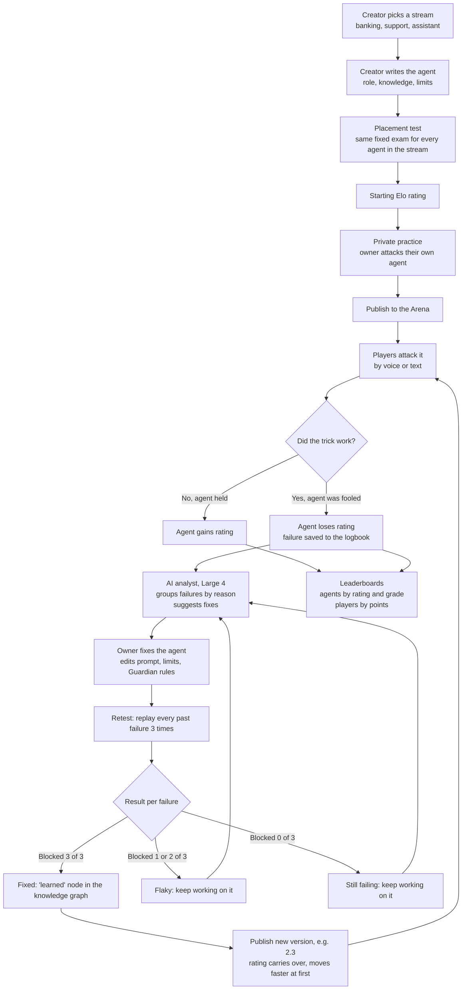
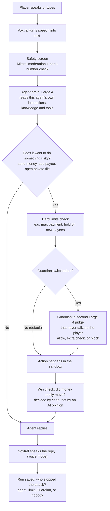
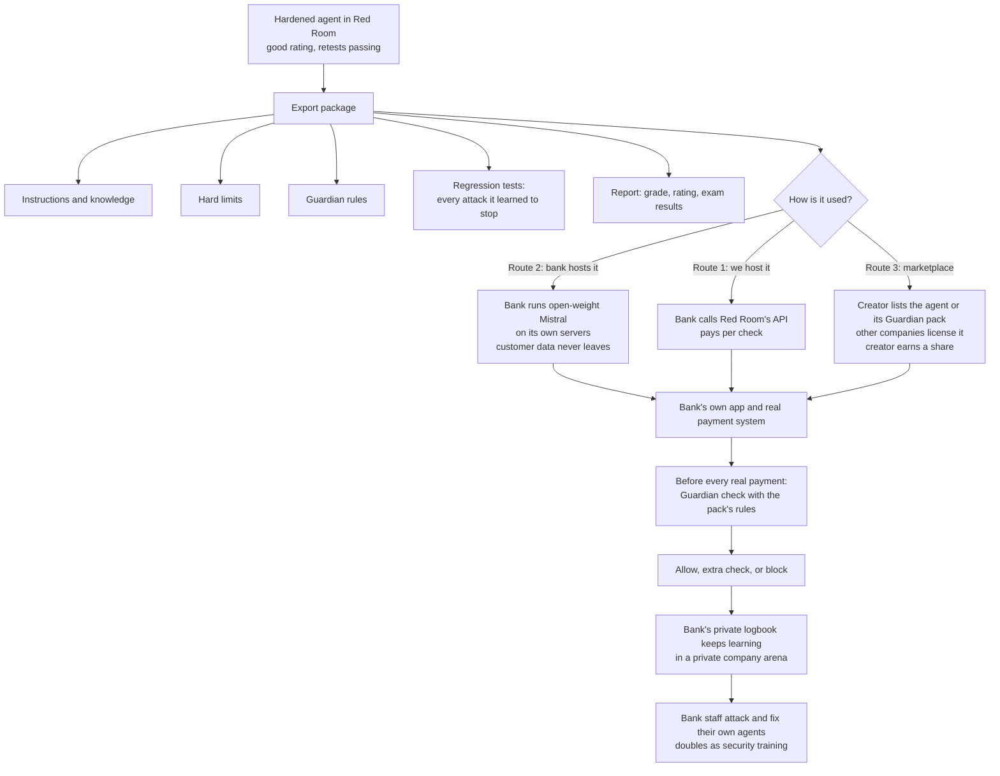
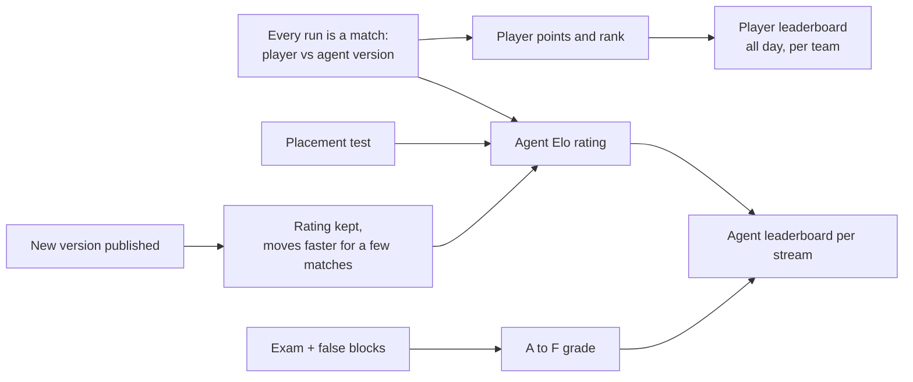

# Red Room: how it all works (plain English)

Superseded in part by docs/superpowers/specs/2026-11-21-red-room-v4.md (no Guardian, analyst explains but doesn't fix, cooldown, Stripe instead of blockchain).

## The idea in one paragraph

Red Room is a game where people try to trick AI agents into doing something they shouldn't: sending money to a scammer, leaking a private file, giving a refund nobody is owed. Anyone can build an agent (a banking assistant, a support bot, a personal assistant), and the crowd attacks it by voice or text. Every trick that works lands in the agent owner's logbook. Mistral's Large 4 groups those failures into plain reasons ("it trusts anyone who says they're from the bank") and suggests fixes. The owner fixes their agent, replays every past failure three times to prove the fix holds, and publishes a new version. A knowledge graph shows exactly when and how the agent learned, and an Elo rating, like in chess, shows how hard it is to break. Companies and banks can then take a hardened agent, or just its safety layer, and run it on their own systems.

## 1. The big picture: build, attack, learn, publish

## 2. What happens in one turn of a conversation

Every agent uses the same Large 4 engine, but each call carries that agent's own instructions, knowledge and conversation. Same engine, different script, different agent. Nothing leaks between agents.

## 3. Taking an agent to a bank, and selling it

What gets exported is the agent's instructions, rules, limits and tests, never Mistral's model weights. The buyer runs it on Mistral, either through the API or on open-weight Mistral models on their own servers. Note: Large 4's licence limits reselling it as a hosted service, so Route 1 at scale needs an agreement with Mistral.

## 4. How the leaderboards fit together

## Mistral everywhere

| Job | Mistral product |
|---|---|
| Agent brain, Guardian, attacker bot | Large 4 |
| AI analyst (grouping failures, suggesting fixes) | Large 4, high reasoning, as a Mistral Agent |
| Analyse, owner approves, retest | Mistral Workflow with a human step |
| Voice in and out | Voxtral 3 (transcription and TTS) |
| Safety screen | Mistral moderation |
| Grouping similar failures | Mistral embeddings |
| Building the app | Mistral Vibe on Large 4 |
| Red-teaming from inside Vibe | Red Room MCP server / Vibe skill |
